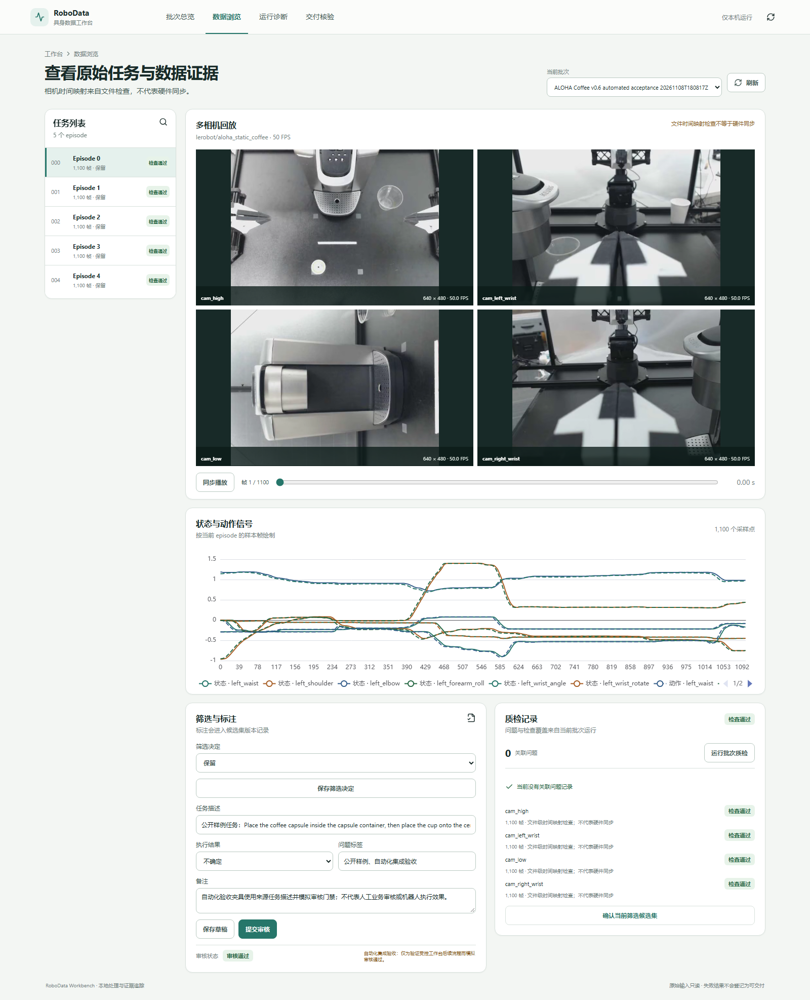
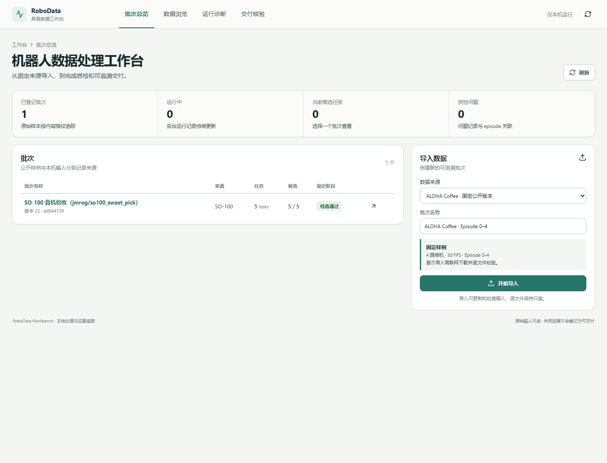
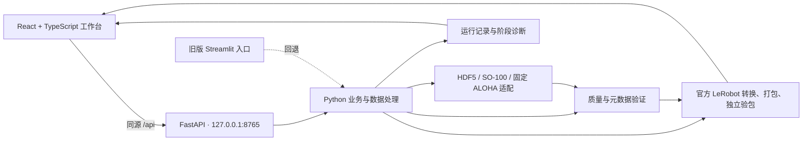

# RoboData Workbench · 具身智能数据处理平台

**v0.6.0 · Windows / Python 3.12 / Node.js 24 · 本地单用户**

把机器人演示数据变成**可检查、可追溯、可验证后交付**的训练样本。新工作台由 React + TypeScript 界面和 FastAPI 本地服务组成；既有 Python 数据处理、质量检查与交付验证仍是业务权威实现。



> 截图于 2026-11-09 从本机 FastAPI 服务生成，展示固定 revision 的真实 ALOHA Coffee Episode 0。Episode 0–4 已完成本地转换与交付验收；标注审核门禁由脚本模拟，未声称人工审核或机器人执行效果。逐路文件时间映射检查不代表硬件同步。详见 [v0.6.0 状态](docs/STATUS_v0.6.0.md) 与 [验收记录](docs/VALIDATION_v0.6.0.md)。

当前展示以通过核验的真实 ALOHA 多相机截图和 SO-100 工作台截图为准；旧录屏含加载或空状态，不作为公开演示素材。

业务链路包含**上传／导入 → 清洗 → 筛选 → 标注审核 → 质检 → 格式转换 → 打包与独立验包**。工作台分为批次总览、episode 与相机浏览、运行诊断、交付核验四类界面；每次处理保留阶段状态、日志和证据。只有通过官方 LeRobot 加载、输出质检、打包和独立验包的产物才可交付。

> **本地边界：** 新工作台只监听 `127.0.0.1`，不提供公网交互服务。仓库现有的 [静态展示页](https://mahonghao1.github.io/Embodied-AI-Data-Processing-Platform/)仍展示早期八节点介绍，不是这里截图所示的新 React 界面。

## 它证明了什么

| 主张 | 证据 |
| --- | --- |
| 新工作台界面 | React + TypeScript 页面、FastAPI 同源托管和批次/运行 API；Node 24 构建、单测与 Chromium 浏览器流程通过 |
| SO-100 主流程 | v0.5.0 固定子集 5 条／3,562 帧通过工作台转换与交付验收；证据见 [v0.5 验收](docs/VALIDATION_v05.md) |
| HDF5 转换与交付 | v0.4 历史验收：116 帧与源 float32 映射一致，官方离线读取和交付包独立验证通过；详见 [v0.4 验收](docs/VALIDATION_v04.md) |
| 多相机处理 | 固定 ALOHA Episode 0–4 实测通过：5,500 帧、四路 640 × 480、50 FPS；各相机帧数与时间映射检查通过 |
| 转换与交付 | 官方离线加载和 5,500 帧数值一致性检查通过；输出质检 55/55 完成；打包 ZIP 独立解包与加载通过 |
| 失败门禁 | 自动测试覆盖缺相机、时间映射错误、未知结构及失败结果拒绝登记；真实数据转换失败和 ZIP 篡改未作故障注入，本次成功产物通过完整登记链 |
| 运行可追溯 | 业务运行按阶段保存请求、状态、事件和诊断；具体真实数据的通过范围以对应版本验收记录为准 |

历史 HDF5 验收：14 个节点全部完成，源任务 0、2 → 输出 2 条／116 帧，端到端 29.26 秒，见 [V0.4 验收](docs/VALIDATION_v04.md)。SO-100 本轮的 UI 开通、5 条／3,562 帧转换及交付证据记录在 [V0.5 验收](docs/VALIDATION_v05.md)，测试证据不代替真实数据运行结果。

## 从哪里开始

- **只想看效果**：查看上方新界面截图和下方验证证据；既有 Pages 是早期静态介绍页
- **想跑起来**：安装 Node.js 24 LTS 后，双击根目录 `首次安装.cmd`，再双击桌面快捷方式 —— 见[安装与启动](#安装与启动)
- **讲给面试官**：[演示路线](docs/demo.md)
- **查实现**：[数据字典](docs/data_dictionary.md)、[V0.5 状态](docs/STATUS_v05.md)、[导航验收](docs/VALIDATION_navigation.md)
- **查当前迭代**：[v0.6.0 状态](docs/STATUS_v0.6.0.md)、[v0.6.0 验收记录](docs/VALIDATION_v0.6.0.md)、[发布说明草稿](RELEASE_NOTES_v0.6.0.md)
- **查操作**：[标准操作 SOP](docs/SOP.md)，[HTML 手册](docs/SOP.html) 可离线打开

默认服务地址为 [http://127.0.0.1:8765/](http://127.0.0.1:8765/)，由 FastAPI 在本机托管构建后的 React 页面和 API。GitHub Pages 不提供该 Python 服务；旧版 Streamlit 可通过 `启动Streamlit旧版.cmd` 单独运行于 8501 端口。

## 安装与启动

### 方式一：一键安装（推荐）

先安装 [Node.js 24 LTS](https://nodejs.org/en/download)，再把仓库克隆或下载到本机，**双击根目录的 `首次安装.cmd`**。向导会检查 Node 版本并完成：

1. 检查并（必要时）安装 uv —— Python 环境管理器，不污染系统 Python
2. 准备 Python 3.12（由 uv 托管）
3. 安装主环境依赖（约 400 MB）
4. 下载公开演示数据（约 46 MB）
5. **在桌面创建「RoboData 工作台」快捷方式**

完成后双击桌面快捷方式启动服务，并在浏览器打开提示中的 `http://127.0.0.1:8765`。首次安装需要联网。

> 完整 HDF5 转换链路（格式转换节点）另需约 2.2 GB（含 CPU 版 PyTorch）。
> 向导会提示可选命令；不安装也不影响浏览、质检与标注功能。

### 方式二：手动安装

需要 Python 3.12、Node.js 24 LTS 和 [uv](https://docs.astral.sh/uv/getting-started/installation/)。获取源码并解压到项目目录，或从实际可访问的仓库克隆源码；在仓库根目录执行 PowerShell 命令：

```powershell
# 安装锁定的 Python 与前端依赖，构建 React 页面
uv sync --locked
Push-Location frontend
npm ci
npm run build
Pop-Location

# 体验 HDF5 批次全流程：预览和转换均需要独立环境
uv sync --project tools/conversion --locked
uv run --locked robodata fetch-hdf5

# 启动本地 API 与页面托管
.\启动工作台.cmd
```

HDF5 样本约 46 MB；独立环境还需下载 CPU PyTorch 等依赖。启动脚本会使用 `npm ci`、`npm run build`（仅当缺少前端依赖或构建产物时）及 `uv sync --locked`，然后由 FastAPI 同源提供页面和 API。服务只监听 `127.0.0.1`。

SO-100 浏览与故障演示另需执行 `uv run --locked robodata fetch-sample`，下载默认子集（5 条 / 3,562 帧）约 53 MB；执行 `获取全量数据.cmd` 可补齐全量 50 条 / 32,068 帧（约 535 MB）。下载器固定版本与文件清单，支持复用、重试和完整性检查；代理只通过下载参数或当前进程变量配置。

v0.6.0 支持固定来源 [ALOHA Coffee](https://huggingface.co/datasets/lerobot/aloha_static_coffee)，代码配置限定在 revision `b144896feb1f37398a862927b22cd3abdf005a6b`、Episode 0–4 和四路相机。固定 revision 的 [LeRobot 元数据](https://huggingface.co/datasets/lerobot/aloha_static_coffee/resolve/b144896feb1f37398a862927b22cd3abdf005a6b/meta/info.json)声明全量 50 条任务、55,000 帧；本机实测的 Episode 0–4 为每条 1,100 帧、共 5,500 帧。四路来源视频经官方 writer 转换为 H.264，并分别检查文件、解码、帧数和记录时间映射；本次结果不证明相机硬件同步。复现步骤与验收边界见 [状态文档](docs/STATUS_v0.6.0.md)。

## 新工作台界面

当前 React 工作台把同一业务流程组织为四类界面：

| 界面 | 主要内容 |
| --- | --- |
| 批次总览 | 来源、episode 数量、当前阶段与候选状态；可导入固定样例或本机数据 |
| 数据浏览 | episode 筛选、视频预览、相机来源与逐路检查、帧与时间映射，以及筛选标注审核 |
| 运行诊断 | 后台运行状态、阶段节点、事件流、错误和登记结果 |
| 交付核验 | 当前版本的转换产物、官方加载/质检证据、打包状态与独立验包 |



上方的 SO-100 截图记录旧版演示用批次；ALOHA 的真实浏览画面见首屏截图。

业务层仍分别记录导入、清洗、筛选、标注、审核、质检、转换和交付阶段。质量检查通过的任务只是候选；只有当前审核、官方加载、输出检查、打包和独立验包全部通过，才登记为可交付。重选或重新标注会使下游审核与产物失效，原始数值不被自动修复。



旧版 Streamlit 页面仍保留作回退入口：双击 `启动Streamlit旧版.cmd`，或运行 `uv run --locked streamlit run app.py`。`docs/assets/v04/` 和早期 Pages 静态页中的逐节点截图属于旧界面，不代表当前 React 页面。

**问题边界：** 机器人执行失败属于任务标注；NaN、缺字段等属于数据质量问题；文件读取、编码或超时属于程序运行问题。记录失败轨迹并不等于宣称机器人成功率或模型训练效果。

## 数据配置与范围

| 来源 | 固定范围 | 字段与处理范围 |
| --- | --- | --- |
| [jmrog/so100_sweet_pick](https://huggingface.co/datasets/jmrog/so100_sweet_pick) | revision `54141acb0bd6bcb868e34b4eb328f26481d333b2`；默认启用 Episode 0–4（3,562 帧）。 | LeRobot v2.0 真机数据，状态／动作各 6 维，laptop 单相机 640×480、30 Hz、AV1 编码；支持 UI 导入、筛选、标注审核、最终质检、v3.0 转换和打包验包。 |
| [robomimic/robomimic_datasets](https://huggingface.co/datasets/robomimic/robomimic_datasets) | revision `74fa018461f479cd9fd15b924a16103012096203`；`test/test.hdf5` 共 demo_0–9（531 帧），默认启用 demo_0–2（174 帧）。 | Panda / Lift 仿真测试片段，状态 9 维、动作 7 维、agentview 84×84 RGB；业务候选子集可转换和打包。 |
| [lerobot/aloha_static_coffee](https://huggingface.co/datasets/lerobot/aloha_static_coffee) | 固定 revision `b144896feb1f37398a862927b22cd3abdf005a6b`；来源元数据声明全量 50 条／55,000 帧和 50 FPS；本机实测 Episode 0–4 共 5,500 帧、四路相机。 | ALOHA 公开示例；逐相机检查文件、解码、帧数和时间映射，不推断相机硬件同步。v0.6.0 的实际转换与交付范围见 [验收记录](docs/VALIDATION_v0.6.0.md)。 |

HDF5 本地上传仍受固定配置约束，不是通用 HDF5 导入器。测试副本必须显式标记；标记不会让结构或质量检查自动通过。

**两种来源都能跑完整条链路**（导入 → 质检 → 筛选 → 标注 → 最终质检 → 转换 → 交付 → 独立验证），转换链路上各有各的适配器：

- **HDF5 → v3.0**：由 `tools/conversion/worker.py` 直接读取 HDF5 的 demo 结构，映射字段后用官方 `LeRobotDataset.create()` 写入。
- **SO-100 v2.0 → v3.0**：源是 LeRobot v2.0，缺 v2.1 要求的 `meta/episodes_stats.jsonl`，因此先补齐 per-episode 统计（数值读 parquet，视频抽帧后走官方 `sample_images`），再逐阶段调用官方转换函数。**官方 `convert_dataset()` 末尾会 `rmtree` 并原地替换源数据集，平台只调用其阶段函数，源数据始终只读。**

状态与动作保留来源语义，不补充未经核对的单位或控制含义。HDF5 时间由 `frame_index/20` 派生；H.264 视频有损。SO-100 视频为 AV1 有损，v2.1→v3.0 是 remux 不重编码，因此不对逐像素恒等作断言，而是核对帧数与解码样本哈希。来源全局统计 9,666 与文件实际 531 帧不一致，作为警告保留，输出按候选任务重新计数。详见 [数据字典](docs/data_dictionary.md) 和 [来源与许可](docs/DATA_NOTICE.md)。

### 调整 HDF5 数据范围

固定样本 `test.hdf5` 实际包含 **10 条 demo（demo_0–9，合计 531 帧）**，默认只启用
demo_0–2（174 帧，与 V0.4 验收一致）。通过 `ROBODATA_HDF5_EPISODES` 可调整范围，
无需修改代码：

```powershell
$env:ROBODATA_HDF5_EPISODES = "0-9"       # 全量 10 条 / 531 帧
$env:ROBODATA_HDF5_EPISODES = "0-2,5,7-9" # 混合区间与单点
.\启动工作台.cmd
```

也可直接双击 **启动工作台全量数据.cmd**。范围变化会改变输入指纹，已有批次需要
重新导入，这是预期行为。越界或非法范围直接失败，不静默降级；校验使用冻结的帧数
清单（`tools/conversion/worker.py` 的 `_ALL_DEMO_LENGTHS`），不从被检文件自证。

> **启动入口命名约束：** 桌面启动器会枚举项目根目录的 `*.cmd` 并执行其中**第一个**，
> 因此 `启动工作台.cmd` 必须保持排序最前。新增启动入口时，文件名不要以排在
> `.`（U+002E）之前的字符开头（如 `-`、`!`、`#`），否则会抢占默认启动，
> 现象是桌面快捷方式"打不开"或启动异常。另外，根目录的 `.cmd` 应保持纯 ASCII
> 内容：`cmd.exe` 按当前代码页解码批处理文件，UTF-8 中文在默认 GBK 代码页下会乱码。

**全量范围已通过端到端验收**（2026-09-12，证据见 `work/full-range-acceptance.json`，
由 `scripts/verify_full_range.py` 生成）：在 `ROBODATA_HDF5_EPISODES=0-9` 下，
10 条 / 531 帧走完导入 → 质检 → 筛选确认 → 标注审核 → 格式转换 → 打包交付 → 独立验证，
输入质检 100/100 项、输出质检 110/110 项、0 数据问题，官方库离线加载并对 531 帧
数值与 30 个采样位置像素比对一致，交付包 531 帧 / 10 条整包路径可移植、独立加载通过。

### 调整 SO-100 数据范围

SO-100 全量 **50 条 / 32,068 帧（约 535 MB）** 已在本地备齐（可执行 `获取全量数据.cmd`
或 `uv run robodata fetch-sample --full`），默认只启用 Episode 0–4（3,562 帧，约 53 MB），
保证日常演示秒开。通过 `ROBODATA_SO100_EPISODES` 可调整：

```powershell
$env:ROBODATA_SO100_EPISODES = "0-49"   # 全量 50 条 / 32,068 帧
$env:ROBODATA_SO100_EPISODES = "0-9"    # 前 10 条
.\启动工作台.cmd
```

**SO-100 历史命令行验收**（2026-09-13，证据见 `work/so100-acceptance.json`，
由 `scripts/verify_so100.py` 生成）：默认 5 条 / 3,562 帧走完导入 → 质检 → 筛选确认
→ 标注审核 → 最终质检 → 格式转换 → 打包交付 → 独立验证，输入质检 55/55 项、
输出质检 55/55 项、0 数据问题，官方库离线加载并对 3,562 帧数值与 15 个采样位置
像素比对一致，交付包 53 MB 路径可移植、解包后独立加载通过。

转换链路额外验证两点：v2.0 → v2.1 阶段为 5 条任务补齐了 per-episode 统计；
源目录在转换前后 SHA-256 不变（平台不原地替换）。

若运行环境的临时文件批量清理被安全策略拦截（表现为转换节点报"工作进程意外退出，
退出码 1"，日志出现 `SAFE_DELETE_BULK_CONFIRM_REQUIRED`），追加设置
`ROBODATA_STREAMING_ENCODING=1`：LeRobot 改用流式编码直接把帧写入视频，
不再落临时图片目录，因此不产生批量删除。默认关闭以保持既有编码路径。

当前范围不包括通用 MCAP 接入、逐帧轨迹修复、多相机硬件同步、模型训练和多人权限系统。基础规则与官方加载通过，不代表训练效果、物理安全或任务成功率。

## 定位异常与查看证据

排查路径：**批次／运行编号 → 失败节点 → 中文原因和文件证据 → 任务、字段、行位置或堆栈 → 处理后启动新运行**。

“运行记录”保存节点状态、耗时和程序日志；“业务审计历史”保存筛选、标注与审核决定。即使最终报告没有生成，已写入的运行日志仍可查看。每次显式执行创建新运行；刷新读取同一记录。

`work/runs/<run_id>/` 保存 `request.json`、`state.json`、`events.jsonl`、节点标准输出／错误日志和阶段证据。批次快照、管理副本位于 `work/business/`。候选内容变化、验证未完成或文件指纹不匹配时，不作为当前有效交付提供下载。

原有故障演示可展开侧栏“高级工具”，在样本页面使用“异常演示副本”“视频缺失演示副本”和“运行超时演示”。具体注入位置及结果含义见 [SOP](docs/SOP.md)。

## 实现与验证

主环境负责页面、轻量读取、质检、后台协调及业务状态；`tools/conversion/` 使用独立 Python 进程完成 HDF5 解析、官方写入与离线加载。两个环境分别锁定依赖。转换组合与维护说明见 [独立环境文档](tools/conversion/README.md)。

```powershell
uv run robodata batches
uv run robodata runs
uv run robodata show-run <run_id> --events
uv run robodata show-flow <batch_id>
# 审核完成后的最终检查；通过后自动完成转换和交付
uv run robodata final-check-batch <batch_id> --revision <revision>
# 对下载 ZIP 在新目录独立校验并官方离线读取
uv run robodata verify-delivery --archive <zip_path>
uv run --locked python -m pytest -q
```

命令中的 `<run_id>`、`<batch_id>`、`<revision>`、`<zip_path>` 需替换为实际编号、修订或路径。更多导入、批次检查和交付验证命令见 SOP。

CI 在 `windows-latest` 上执行同一组测试（[`.github/workflows/tests.yml`](.github/workflows/tests.yml)）；需要独立转换环境与固定样本的用例在缺失时自动跳过，其余用例不依赖下载数据。

[V0.1](docs/validation.md)、[故障样本验证](docs/failure_validation.md)、[V0.2](docs/VALIDATION_v02.md)、[V0.3](docs/VALIDATION_v03.md) 保留各阶段的实测范围与结果。V0.3 的 91 项测试和固定三条转换结果属于历史基线。V0.4 真实自动链保留源任务 0、2，输出 2 条／116 帧；全量 float32 数值比对、6 个图像位置与官方读取一致、22/22 项输出质检及交付包独立加载通过。异常副本另验证任务隔离、剩余 57 帧转换和篡改 ZIP 拒绝。最终测试与实际浏览器操作按 [V0.4 验收](docs/VALIDATION_v04.md) 的范围阅读，不以界面测试代替真实数据验证。

原始数据、管理副本、运行日志、报告和交付 ZIP 默认保存在被 Git 忽略的 `data/`、`work/`、`reports/`。历史证据中引用的本地产物需自行复现，不随源码自动下载。

首屏截图 `docs/assets/workbench-v0.6.0-aloha.png` 来自通过验收的真实 ALOHA Episode 0 四路相机浏览；`docs/assets/workbench-v0.6.0.png` 展示 SO-100 工作台界面，不把它描述为 ALOHA 转换证据。

## 设计取舍

关键决策都放弃了什么，写在这里而不是藏起来。

| 决策 | 选择 | 放弃的 |
| --- | --- | --- |
| 数据列式存储 | Parquet | 放弃 MCAP 的流式写入与 ROS 生态直连；换取与 LeRobot 官方格式一致和 Pandas 生态 |
| 运行环境 | 主环境与 `tools/conversion/` 双环境隔离 | 放弃单环境部署的便利；换取 torch / h5py 重依赖不污染页面环境 |
| 视频编码 | H.264 | 放弃无损；换取体积与官方加载器兼容性，因此文档明确标注图片为有损 |
| 时间派生 | HDF5 按 `frame_index / 20` | 源数据无时间戳字段，放弃精确同步；换取可复现的确定性派生 |
| 清洗策略 | 任务级隔离，不自动删帧、插值或修轨迹 | 放弃自动修复；换取原始数据不被静默改动，每条隔离必须填原因 |
| 失败建模 | 任务失败 / 数据异常 / 程序失败 三类分开 | 放弃单一成功失败判断；换取完整失败轨迹仍可作为有效数据保留 |
| 产物失效 | 内容版本或哈希变化即标记历史 | 放弃"永远可下载"的便利；换取不会误把过期产物当当前有效交付 |

## 许可

[MIT](LICENSE)。数据来自公开数据集，来源与许可见 [DATA_NOTICE.md](docs/DATA_NOTICE.md)。


