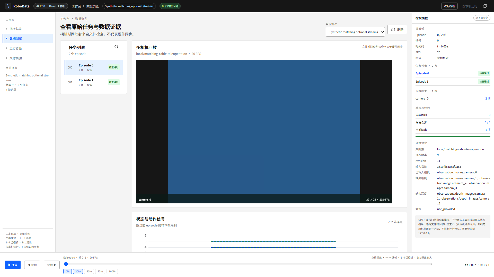

# Matching Cable 本机遥操数据

这个适配器接收 Matching Cable 的逐帧 HDF5 目录，并把**实际存在的流**写进批次清单。缺失的相机、深度或可选数值字段不再直接报错，而是记录为 `not_provided`，在预览、质检、界面和交付说明中逐条可见。



> 这张图来自 2 Episode × 2 帧的合成夹具，视频是 32×24 纯色画面；它的作用是证明缺失流在界面上逐条可见，不是真实 Matching Cable 数据的效果图。

## 目录与必填字段

父目录下每个数字目录是一条 Episode（例如 `68`–`74`），每个 `.hdf5` 是一帧：

```text
matching_cable/
  68/
    0.hdf5
    1.hdf5
  70/
    0.hdf5
    ...
```

必填：

| 字段 | 维度 | 用途 |
| --- | --- | --- |
| `master/joint_position` | float32[16] | `action` |
| `puppet/joint_position` | float32[16] | `observation.state` |
| `timestamps` | 单值毫秒 | 校验 50 ± 10 ms/帧，输出按 20 FPS 派生 |

至少需要一路 RGB 相机；没有任何 RGB 时明确失败，因为当前预览和时间轴需要至少一路视频。

## 可选流

| 流 | 字段 | 缺失时 |
| --- | --- | --- |
| RGB 相机 | `observations/rgb_images/camera_0..3` | 只写入存在的相机；其余记入 `missing_cameras` |
| 深度 | `observations/depth_images/camera_1..2` | 存在的校验可读；缺失记入 `missing_depth_source_cameras`，不阻断 |
| 末端位姿 | `puppet/eef`、`master/eef` | 缺失记入 `optional_fields=not_provided`，不写入特征 |
| 关节力矩 / 六维力 | `puppet/joint_effort`、`puppet/6f` | 同上 |
| 触觉 | 未建模 | 固定记录 `tactile.status=not_provided`；缺失或存在都不影响导入 |

清单会同时记录 `cameras`、`missing_cameras`、`depth_source_cameras`、`missing_depth_source_cameras`、`optional_fields` 和 `tactile`。转换只写入实际存在的特征；`official_verify` 明确区分：

- `output_loader_consistency_checked=true`：输出 parquet 与官方加载器一致；
- `source_numeric_consistency_rechecked=false`：本次没有重新读取源 HDF5 做逐帧数值回核。

## 怎么跑

完整业务链路从界面导入父目录或单条 Episode 目录，选择「Matching Cable · 单帧 HDF5 遥操目录」。也可以直接用 CLI：

```bash
uv run --locked robodata import-batch \
  --input "E:/遥操数据/matching_cable" \
  --source matching_cable \
  --label "Matching Cable 68-70" \
  --runs-root work/runs \
  --business-root work/business
```

预览和转换需要独立环境（包含 h5py、PyTorch、LeRobot）：

```bash
uv sync --project tools/conversion --locked
uv run --project tools/conversion --locked python tools/conversion/matching_preview.py \
  --input "E:/遥操数据/matching_cable" --output work/matching-preview
```

## 合成回归

不需要 9 GB 真实数据。下面的脚本会生成 2 条 Episode × 2 帧、只有一路 RGB、没有深度/触觉/可选数值的夹具，跑完预览、六个转换/验证阶段并断言缺失流可见：

```bash
uv run --locked python scripts/verify_matching_optional.py
```

期望输出：

- `cameras` 只有 `observation.images.camera_0`；
- `missing_cameras` 3 路，`missing_depth_source_cameras` 2 路；
- `optional_fields` 全部 `not_provided`，`tactile.status=not_provided`；
- 6 个阶段通过，`output_loader_consistency_checked=true`、`source_numeric_consistency_rechecked=false`。

原始报告写在 `work/matching-optional/report.json`，不随仓库分发。

## 边界

- 不声明相机硬件同步；逐路文件时间映射不等于硬件同步。
- 不声明策略训练效果、任务成功率或生产容量。
- 缺失流是**来源事实**，不是自动修复；平台不会补造深度、触觉或相机画面。
- 本适配器只读取上述字段；其他 Matching Cable 字段不会进入交付。
